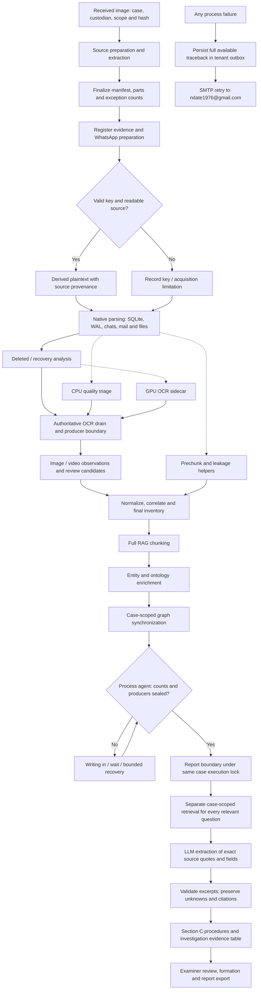

# V78 - Android completeness, independent producers and forensic investigation

The Android pipeline and shared Disk/Mobile control/report paths now expose honest completion labels, protect parallel writes, and add case-scoped investigation questions. The full review and diagrams are in `docs/ANDROID_FORENSIC_FLOW_AND_PROCESS_V78.pdf`; the first diagram also has a vector SVG copy.

## Completion and status

The requested UI labels are `wait`, `next`, `in process`, `writing in`, `completed`, and `failed`. The API adds `process_status` while retaining internal statuses needed by the existing dispatcher. A paused process remains explicitly paused; skipped/failed evidence exceptions remain visible.

- The controller seals a stage only after the isolated worker returns, its counters balance, and persisted database barriers pass.
- The monitor explains a 99% denominator instead of completing a still-live producer.
- Empty sidecar OCR buckets do not mark the authoritative OCR stage completed.
- Inventory, chunking and report entry wait for independent writers. Current-stage work is excluded from its entry barrier so resumable work can actually be processed.
- Full processing completion is different from full evidence coverage. Missing keys, unreadable or unsupported evidence, disabled OCR, failed records and acquisition gaps remain limitations; 100% is not an accuracy or recovery claim.

## Full Android flow



## Parallel-work conditions

| Work | Permitted overlap | Completion condition |
| --- | --- | --- |
| Native parsing | CPU quality triage and parsed-text helpers | Native work plus normalized work accounted for |
| Recovery | GPU OCR and independent CPU helpers | Recovery returns; authoritative OCR drain follows |
| Quality triage | Parsing and recovery | Same tenant/job producer lock; no late write after OCR seal |
| Prechunk / leakage | Parsed-evidence windows | Atomic token claim; one sidecar executor; drained before dependent finalization |
| Inventory | CPU inventory sidecar may run during OCR | Final authoritative inventory and leakage pass after producers drain |
| Reporting | Other independent cases | No same-case source stage; report shares the case execution lock |

Sessions, claims, artifact identities, retrieval and graph traversal remain case scoped. Helper admission fails closed when resource accounting is unavailable. This avoids silently increasing concurrency at the expense of stable output; it does not eliminate shared-host CPU, disk or database contention.

## Investigation questions and LLM output

The supplemental bank has 22 question groups in `backend/app/services/forensic_investigation_questions.py`. Relevant groups are appended to each matching Procedure, not substituted for the controlled counting rules. Each group gets its own job/tenant-scoped hybrid query. A report-local cache reuses retrieval only for the same tenant, job and question.

The LLM proposes an exact excerpt and literal offer/transfer fields. Code rejects an invented excerpt, foreign-job hit, unknown source ID or field not present in the quoted source. The persisted investigation table shows the question, result, source path, record/chunk ID, excerpt and available fields. Findings remain candidates requiring examiner review; a bounded retrieval miss never proves absence. Unavailable services produce `not examined`, not fabricated findings. Saved reports restore the supplemental findings after an interrupted generation.

No general claim of confidentiality, intent, policy violation, accepted employment or unauthorized transfer is generated solely from file presence or a keyword. Check originals, account attribution, conversational context and company policy.

## Email alerts

- Existing SMTP settings are reused; no credentials are added by this release.
- Default failure recipient: `ndate1976@gmail.com`; optional override: `FORENSIC_FAILURE_EMAIL`.
- `FORENSIC_FAILURE_MAIL_ENABLED=false` pauses alert mail independently of identity mail settings.
- Full child traceback crosses the subprocess boundary without truncation. The failure state and outbox entry are persisted before delivery.
- Keep progress and beat workers enabled. Email delivery runs asynchronously on the product's existing progress queue.
- SMTP outages retain pending alerts with bounded backoff. Event keys suppress duplicate records for one job/stage/attempt.
- Delivery is at least once. Ambiguous SMTP acknowledgement or a crash after acceptance can duplicate mail. A hard process kill may provide no Python traceback; retry-exhaustion alerts identify the available context.

The outbox and claim indexes are created automatically in the tenant schema. Processing never becomes successful merely because an email was accepted.

## Build and install

From project root, for the root forensic stack:

```powershell
docker compose build --no-cache api frontend
docker compose up -d --no-build
docker compose exec -T api python scripts/install_process_indexes_v78.py
```

For an existing separate Android stack:

```powershell
$dcArgs = @('-f','services/mobile-android/docker-compose.yml','--project-directory','.')
docker compose @dcArgs build --no-cache api frontend
docker compose @dcArgs up -d --no-build
docker compose @dcArgs exec -T api python scripts/install_process_indexes_v78.py
```

The optional installer creates online expression indexes used by mobile and priority-record completeness joins. It enumerates existing firm schemas, uses quoted identifiers and AUTOCOMMIT for CREATE INDEX CONCURRENTLY, and refuses an interrupted invalid index instead of silently treating it as installed. Apply it to new firm schemas when created. Do not drop or recreate evidence volumes. Use the compose file already hosting the relevant case rather than starting a second independent copy of it.

## Verification and limits

`V78_TEST_RESULTS.txt`: 99 passing focused checks. Android TypeScript/Vite production build passed; Python compilation passed. Tests include producer barriers, case isolation, quote validation, full remote trace preservation, SMTP retry state, quality locking, OCR overlap, mobile counts and single-image build reuse.

`V78_BASELINE_TEST_RESULTS.txt` records original-upload failures reproduced separately. They include obsolete four-worker expectations, materialization mocks that omit the WhatsApp gate, old procedure wording assertions and one nondeterministic old barrier test. This release does not claim the complete historical test suite is clean.

Not executed here: real evidence extraction, live PostgreSQL races or EXPLAIN plans, CUDA/OCR benchmarks, live SMTP delivery or actual-case PDF/DOCX pagination. Validate these on a representative copy of your evidence before production use. There is no measured files/minute, recovery-rate or factual-accuracy claim. Vulnerability scanner engines and scoring are outside this requested Android change; vendor feature parity is not claimed.
